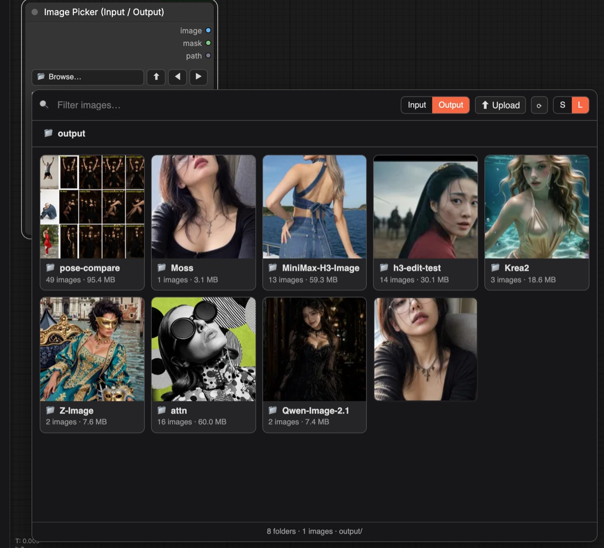
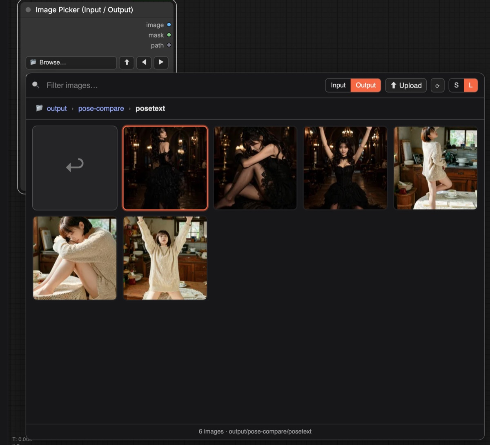

# ComfyUI-Penguinhelmet

A pack of custom nodes for ComfyUI. The nodes appear under the
**penguinhelmet** category.

| Node | What it does |
|---|---|
| [Image Picker (Input / Output)](#image-picker-input--output) | Load an image from `input/` or `output/` through a folder gallery, or upload one |

## Install

**ComfyUI Manager:** *Install via Git URL* and paste
`https://github.com/penguinhelmet/ComfyUI-Penguinhelmet`

**Manual:**

```sh
cd ComfyUI/custom_nodes
git clone https://github.com/penguinhelmet/ComfyUI-Penguinhelmet
```

Restart ComfyUI. No extra Python packages are needed.

To update, run `git pull` inside the folder and restart ComfyUI.

---

## Image Picker (Input / Output)

A Load Image node that picks from **both** the `input/` and `output/` folders. It
opens a gallery where you click into folders, use the breadcrumb path to go back,
and click an image to choose it. You can also upload from your own computer, even
when ComfyUI runs on a remote server.




- **Input / Output switch**: use any generated image as an input, with no copying
  into `input/`
- **Folder gallery**: each folder shows its newest image as a cover, with an image
  count and total size, newest folders first
- **Breadcrumb path** (`output › pose-compare › native`): click any part to jump
  back. Backspace or the ↩ tile goes up one level
- **Search** across all subfolders of the current folder
- **S / L** thumbnail size
- **Upload** from the browser's computer, or drag & drop onto the node. Files go to
  `input/` (into the open folder when browsing Input)
- **+ Folder** creates a folder in `input/`
- **◀ ▶** on the node step through the images in the same folder

Outputs: `image`, `mask` (same as core Load Image) and `path` (absolute file path).

### Local or remote

It works on a normal local ComfyUI (Desktop, Portable or a manual install) with
no extra setup. SSH is only needed if you open a ComfyUI that runs on a
*different* machine.

Everything goes through the ComfyUI server, so it works the same when ComfyUI
runs on another machine. Listing, thumbnails and loading happen on the server.
**Upload** sends the file from the computer running the browser to the server's
`input/` folder. For example, over an SSH tunnel:

```sh
ssh -L 8188:127.0.0.1:8188 user@server
# then open http://127.0.0.1:8188 in the local browser
```

### Notes

- The saved value looks like `subfolder/name.png [output]`. A value without a tag
  means `input/`, like core Load Image.
- Paths are checked to stay inside `input/` or `output/`.
- Thumbnails are WebP, made on demand and cached in memory (600 entries).

---

## Adding a node (for contributors)

1. Put the Python node in `nodes/<name>.py` and export `NODE_CLASS_MAPPINGS` and
   `NODE_DISPLAY_NAME_MAPPINGS`. The package `__init__.py` picks it up
   automatically.
2. Put frontend code (if any) in `js/<name>.js`.
3. Prefix node ids with `PH_` and use the `penguinhelmet/...` category.

## About and license

- **Where it lives:** this GitHub repository is the only home of the pack. Bug
  reports and ideas are welcome in
  [Issues](https://github.com/penguinhelmet/ComfyUI-Penguinhelmet/issues).
- **License:** [MIT](LICENSE). You can use, copy, change and share the code,
  including in commercial work. Keep the copyright notice with it.
- **Built with AI help:** much of the code was written with an AI coding
  assistant. Every node is tried in a real ComfyUI before it is released.
- **No warranty:** the software comes as is. Keep a backup of workflows and images
  you care about.

ComfyUI-Penguinhelmet is an independent, personal project. It is not affiliated
with, endorsed by or sponsored by Comfy Org or the ComfyUI project. Product names
and trademarks belong to their owners.
